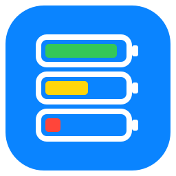

# Batterie in Barra

Mini batterie per cuffie, tastiera, mouse e controller Bluetooth **direttamente sulla barra di Windows**,
a sinistra delle icone vicino all'orologio. Con un clic si apre un widget con cerchi, tempo stimato e grafico
delle ultime 24 ore.

Scritta in **C# (WPF, .NET 10)**: leggera, senza PowerShell né browser dentro.

## Come si usa

1. Scarica `BatterieInBarra-Setup-x.y.z.exe` dalle **Releases** e installalo
   (oppure `BatterieInBarra-x.y.z.exe`, da aprire senza installare: mettilo in una cartella fissa)
2. Le versioni nuove arrivano da sole (aggiornamento automatico)
3. **Clic** sulle batterie (o **Ctrl + Alt + B**): widget. **Tasto destro**: Aggiorna, Impostazioni, Sposta, Esci

## Come pubblicare una versione nuova

1. Scrivi le novità in cima a `docs/CHANGELOG.md`, in una sezione `## 0.3.4 — data (titolo)`
2. Dal terminale:
   ```
   git pull && git add . && git commit -m "Versione 0.3.4" && git push && git tag v0.3.4 && git push origin v0.3.4
   ```
3. GitHub compila da solo e crea la release "Batterie in Barra 0.3.4" con l'exe

A ogni push GitHub controlla che il codice compili e fa partire i **test automatici**
(Actions → "Controlla che compili"). I test stanno nella cartella `Test`.

L'app installata cerca da sola le versioni nuove nelle Releases di questo repository (che quindi deve essere
**pubblico**) e si aggiorna tenendo i dati.

## I file

- `App.xaml.cs` - il cervello: legge le batterie, aggiorna barra e widget, avvisi
- `Batterie.cs` - chiede a Windows la batteria dei dispositivi Bluetooth collegati
- `Finestre.cs` - funzioni di Windows: posizione della barra, schermo intero, finestre sempre davanti
- `Impostazioni.cs` - legge e salva le impostazioni
- `Cronologia.cs` - si ricorda la batteria nel tempo (grafici e tempo stimato)
- `Statistiche.cs` - cariche del mese, durata media di una carica, salute della batteria
- `Testi.cs` - tutte le scritte in italiano, inglese e tedesco
- `AirPods.cs` - legge la batteria di AirPods e Beats dai messaggi Bluetooth di Apple
- `PlayStation.cs` - legge la batteria dei controller PS4 e PS5 dai loro dati
- `Risorse/` - l'icona dell'app (`icona.ico` per Windows, `icona.png` per le notifiche e questa pagina)
- `Avvisi.cs` - le notifiche di Windows
- `Aggiornamenti.cs` - cerca le versioni nuove su GitHub e le installa
- `Registro.cs` - il registro dell'app (avvii, aggiornamenti, errori)
- `installer.iss` - il programma di installazione (Inno Setup)
- `Test/` - i test automatici
- `Grafica.cs` - colori, tema chiaro/scuro, icone e mini batterie
- `BarraWindow` - le mini batterie sulla barra
- `WidgetWindow` - il widget con cerchi, lista e grafico
- `ImpostazioniWindow` - la finestra Impostazioni
- `AggiornamentoWindow` - la barra di avanzamento durante l'aggiornamento

Le impostazioni e la cronologia vengono salvate in `%APPDATA%\BatterieInBarra`.

## Compilare sul PC Windows (facoltativo)

Serve il .NET 10 SDK. Poi nella cartella del progetto:
```
dotnet run
```
